# Taller 3. Publicar mi página personal en una VM de OCI

| | |
| --- | --- |
| **Estudiante** | David Correa |
| **Asignatura** | Infraestructura TI y Cloud Computing (2026-2) |
| **Sitio publicado** | http://davidcorrea-oci.duckdns.org |
| **Repositorio** | https://github.com/DavoCor/pagina-personal-oci |

## Objetivo

Crear una máquina virtual nueva en OCI (Oracle Cloud Infrastructure, infraestructura de nube de Oracle) reutilizando la red del taller 1, instalar Nginx, publicar una página web propia y darle un nombre fácil de recordar con un subdominio gratuito de DuckDNS. La página se verifica desde un navegador externo a la máquina virtual.

## Datos del taller

| Elemento | Valor |
| --- | --- |
| Región | Región principal de la cuenta (Bogotá) |
| Compartimento | `Infraestructura_y_Cloud` |
| Usuario de trabajo | `estudiante-web` |
| Red y subred (reutilizadas del taller 1) | `red-infraestructura` / `subred-web` |
| Máquina virtual nueva | `servidor-personal` |
| Imagen y forma | Oracle Linux 9, `VM.Standard.E5.Flex` (1 OCPU, 16 GB de memoria) |
| Llave SSH | `llave-personal.key` (no se publica en el repositorio) |
| Dirección IP pública | `157.137.218.28` |
| Subdominio | `davidcorrea-oci.duckdns.org` |
| Carpeta que publica Nginx | `/usr/share/nginx/html` |

## Requisitos de la página y cómo se cumplen

| Requisito | Dónde está |
| --- | --- |
| Al menos tres secciones | Inicio, Resumen de los talleres, Preguntas de opción múltiple, Verdadero o falso y Tarjetas de repaso (`sitio/index.html`) |
| Imágenes | Cuatro imágenes SVG en `sitio/img/`: iniciales (`perfil.svg`), nube, diagrama de la red y favicon |
| CSS adaptable a móviles | `sitio/css/estilos.css`: con `@media (max-width: 900px)` y `@media (max-width: 700px)` las tarjetas pasan a dos y a una columna y aparece el botón **Menú**; el título usa `clamp()` |
| Funcionalidad en JavaScript | `sitio/js/app.js`: juegos de repaso de los talleres 1, 2 y 3 (opción múltiple con puntaje y filtro por taller, verdadero o falso y tarjetas que se voltean), modo oscuro, menú para celular y aviso de la dirección desde la que se ve la página |

## Estructura del repositorio

```
pagina-personal-oci/
├── README.md          <- esta guía
├── .gitignore         <- evita subir llaves y credenciales
├── capturas/          <- capturas de pantalla de cada paso
└── sitio/             <- la página que publica Nginx
    ├── index.html
    ├── css/estilos.css
    ├── js/app.js
    └── img/           <- imágenes SVG
```

## Tabla de contenido

- [Fase 1. Preparar el repositorio con la página](#fase-1-preparar-el-repositorio-con-la-página)
- [Fase 2. Crear la nueva máquina virtual](#fase-2-crear-la-nueva-máquina-virtual)
- [Fase 3. Instalar Nginx y publicar la página](#fase-3-instalar-nginx-y-publicar-la-página)
- [Fase 4. Configurar el subdominio de DuckDNS](#fase-4-configurar-el-subdominio-de-duckdns)
- [Fase 5. Resultado y mantenimiento](#fase-5-resultado-y-mantenimiento)
- [Solución de problemas](#solución-de-problemas)

---

## Fase 1. Preparar el repositorio con la página

La página se guarda en un repositorio público de GitHub. Así la máquina virtual puede descargarla con `git`, igual que en el taller 2, y esta guía queda en el mismo lugar.

### Paso 1.1. Crear el repositorio público

1. Inicia sesión en `github.com` y pulsa **New repository**.
2. Completa el formulario:

| Campo | Valor |
| --- | --- |
| Repository name | `pagina-personal-oci` |
| Visibility | **Public** |
| Add a README file | Sin marcar |

3. Pulsa **Create repository**. El repositorio debe ser público para que el docente vea la guía y para que la máquina virtual lo descargue sin contraseña.

### Paso 1.2. Subir la página desde el computador

En una terminal, dentro de la carpeta `pagina-personal-oci`, ejecuta:

```bash
git init -b main
git add .
git commit -m "Agregar página personal"
git remote add origin https://github.com/DavoCor/pagina-personal-oci.git
git push -u origin main
```

| Orden | Qué hace |
| --- | --- |
| `git init -b main` | Convierte la carpeta en un repositorio con la rama `main` |
| `git add .` | Prepara todos los archivos para guardarlos |
| `git commit -m ...` | Guarda una versión con un mensaje que la describe |
| `git remote add origin ...` | Conecta la carpeta con el repositorio de GitHub |
| `git push -u origin main` | Sube la versión a GitHub |

El archivo `.gitignore` impide que se suban llaves (`*.key`, `*.pem`) y el archivo `datos-taller.txt`, aunque estén por error dentro de la carpeta.

En GitHub, comprueba que aparezcan `sitio/index.html`, `sitio/css`, `sitio/js` y `sitio/img`.

<!-- Captura: repositorio en GitHub mostrando la carpeta sitio y su contenido -->
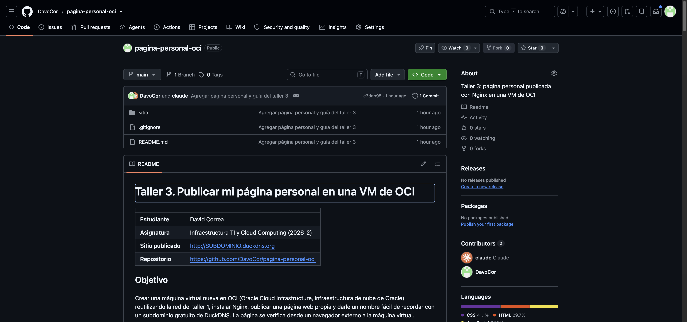

---

## Fase 2. Crear la nueva máquina virtual

Se crea una máquina distinta a la del taller 2 dentro de la red que ya existe.

### Paso 2.1. Comprobar la red del taller 1

1. Abre una ventana privada, entra a `cloud.oracle.com` con tu cuenta, tu dominio y el usuario `estudiante-web`.
2. Selecciona la región de la cuenta y el compartimento `Infraestructura_y_Cloud`.
3. Abre **Networking > Virtual cloud networks > red-infraestructura** y comprueba que exista `subred-web` como subred pública.
4. Abre **Security > Default Security List for red-infraestructura > Ingress Rules** y comprueba las reglas de entrada:

| Source CIDR | IP Protocol | Destination Port Range |
| --- | --- | --- |
| `0.0.0.0/0` | TCP | `22` |
| `0.0.0.0/0` | TCP | `80` |

> Si la red se eliminó al cerrar el taller 2, créala de nuevo con la fase 2 del taller 1 antes de continuar.

<!-- Captura: lista de seguridad con las reglas de los puertos 22 y 80 -->
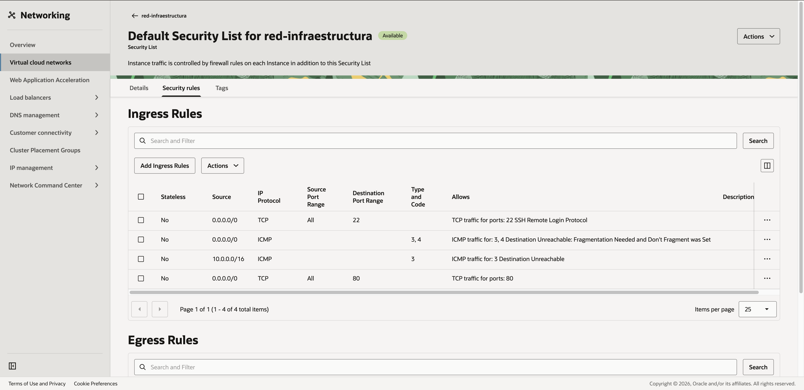

### Paso 2.2. Elegir nombre, imagen y forma

1. Abre **Compute > Instances**, selecciona `Infraestructura_y_Cloud` y pulsa **Create Instance**.
2. Completa:

| Campo | Valor |
| --- | --- |
| Name | `servidor-personal` |
| Compartment | `Infraestructura_y_Cloud` |
| Image | **Oracle Linux 9** |
| Shape | **Virtual Machine > AMD >** `VM.Standard.E5.Flex` |
| OCPU | `1` |
| Memory (GB) | `16` |

<!-- Captura: imagen Oracle Linux 9 y forma seleccionadas -->
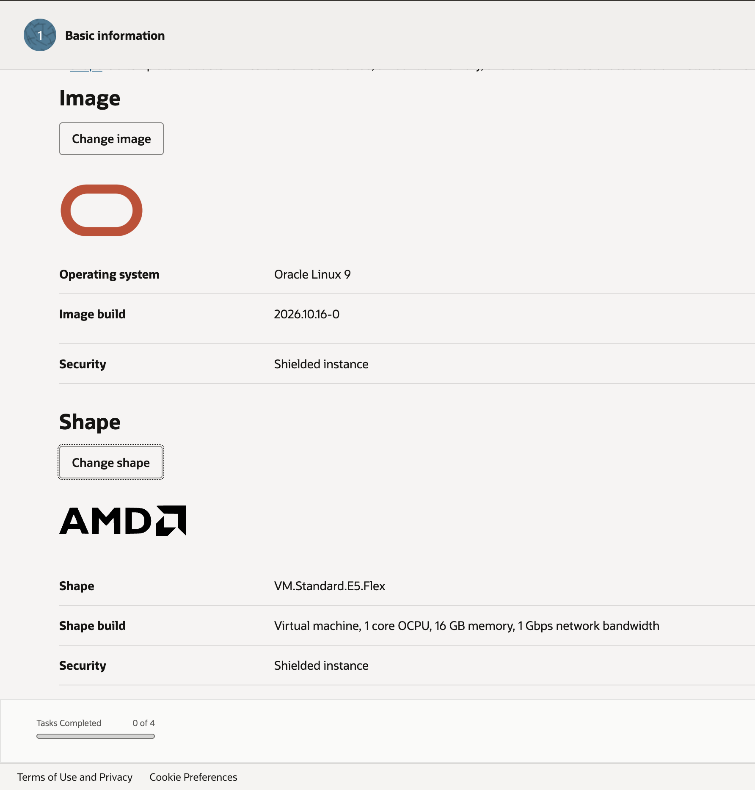

### Paso 2.3. Conectar la máquina a la red

| Campo | Valor |
| --- | --- |
| Virtual cloud network | `red-infraestructura` (existente) |
| Subnet | `subred-web` (existente) |
| Assign a public IPv4 address | Activado |
| Network security groups | Sin habilitar |

<!-- Captura: sección Networking con la red y la subred existentes -->
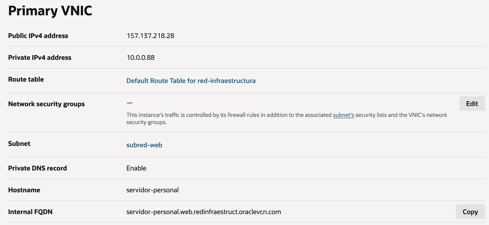

### Paso 2.4. Generar la llave y crear la máquina

1. En **Add SSH keys**, selecciona **Generate a key pair for me** y descarga **Save Private Key** y **Save Public Key**.
2. Renombra el archivo privado como `llave-personal.key`. Este archivo nunca se sube a GitHub.
3. Conserva el disco de arranque predeterminado y pulsa **Create**.
4. Espera el estado **Running** y dos minutos más para que el sistema termine de iniciar.
5. Copia **Public IP Address** y guárdala en `datos-taller.txt`. En mi caso es `157.137.218.28`.

<!-- Captura: llaves descargadas (solo los nombres de los archivos) -->
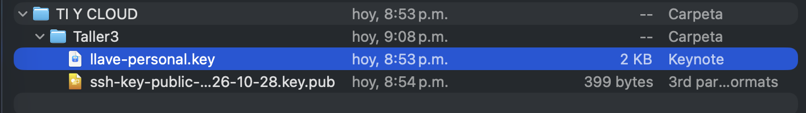

<!-- Captura: instancia servidor-personal en Running con su IP pública -->
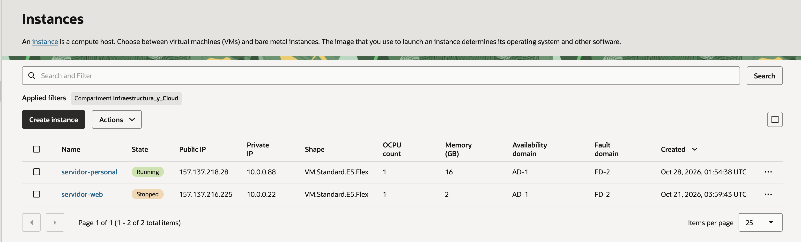

---

## Fase 3. Instalar Nginx y publicar la página

### Paso 3.1. Conectarse por SSH desde Cloud Shell

1. Abre **Cloud Shell** desde la barra superior y comprueba que use **Public Network**.
2. En el menú de Cloud Shell, selecciona **Upload** y carga `llave-personal.key`.
3. Ejecuta en Cloud Shell:

```bash
ls -l ~/llave-personal.key
chmod 600 ~/llave-personal.key
```

`ls -l` confirma que el archivo se cargó y `chmod 600` deja la llave legible solo para tu usuario; SSH rechaza llaves con permisos abiertos.

<!-- Captura: ls -l y chmod en Cloud Shell -->
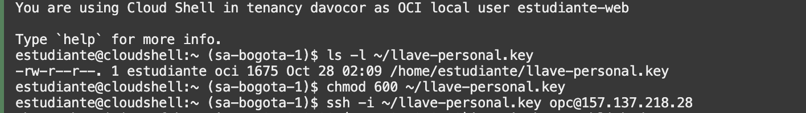

4. Conéctate a la máquina nueva y comprueba el usuario:

```bash
ssh -i ~/llave-personal.key opc@157.137.218.28
```

```bash
whoami
```

Escribe `yes` en la primera conexión. La orden `whoami` debe responder `opc`.

<!-- Captura: conexión SSH y respuesta opc -->
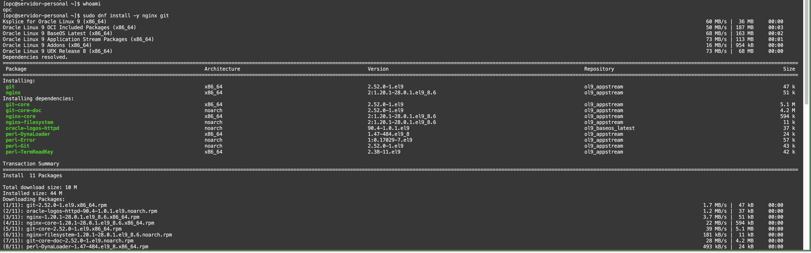

### Paso 3.2. Instalar Nginx y Git

Ejecuta dentro de `servidor-personal`:

```bash
sudo dnf install -y nginx git
sudo systemctl enable --now nginx
systemctl is-active nginx
```

| Orden | Qué hace |
| --- | --- |
| `dnf install -y nginx git` | Instala el servidor web Nginx y Git |
| `systemctl enable --now nginx` | Inicia Nginx ahora y lo deja configurado para iniciar con el sistema |
| `systemctl is-active nginx` | Comprueba el estado; debe responder `active` |

<!-- Captura: fin de la instalación con Complete! -->
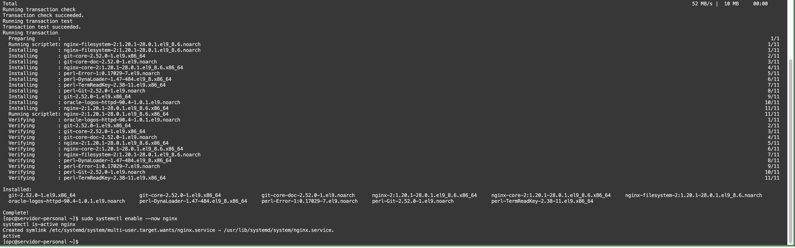

<!-- Captura: systemctl is-active nginx respondiendo active -->
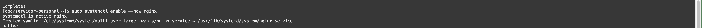

### Paso 3.3. Descargar la página desde GitHub

```bash
git clone --depth 1 https://github.com/DavoCor/pagina-personal-oci.git ~/pagina-personal
ls -R ~/pagina-personal/sitio
```

`--depth 1` descarga solo la última versión del repositorio. `ls -R` muestra los archivos de la página y sus subcarpetas.

<!-- Captura: git clone y listado de la carpeta sitio -->
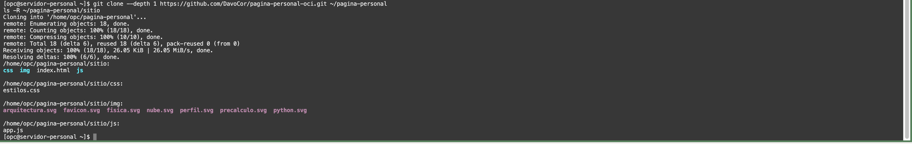

### Paso 3.4. Copiar la página a la carpeta de Nginx

```bash
git -C ~/pagina-personal archive --format=tar HEAD:sitio | sudo tar -x -C /usr/share/nginx/html
sudo restorecon -Rv /usr/share/nginx/html
ls -l /usr/share/nginx/html
```

| Orden | Qué hace |
| --- | --- |
| `git archive ... HEAD:sitio` | Empaqueta solo el contenido de la carpeta `sitio`, sin la guía, las capturas ni la carpeta interna `.git` |
| `tar -x -C /usr/share/nginx/html` | Extrae ese contenido en la carpeta que entrega Nginx |
| `restorecon -Rv` | Aplica la etiqueta de SELinux que permite a Nginx leer los archivos |
| `ls -l` | Comprueba que estén `index.html`, `css`, `js` e `img` |

<!-- Captura: archivos de la página dentro de /usr/share/nginx/html -->
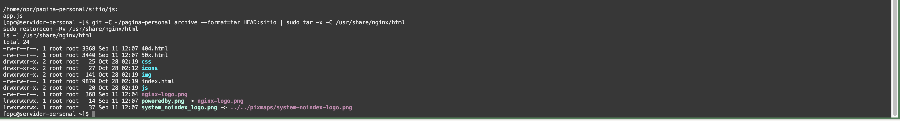

### Paso 3.5. Abrir HTTP en el firewall del servidor y probar localmente

La lista de seguridad de OCI ya permite el puerto 80, pero Oracle Linux tiene su propio firewall. Ambos controles deben permitir el tráfico.

```bash
sudo firewall-cmd --permanent --add-service=http
sudo firewall-cmd --reload
curl -I http://localhost/
```

Las dos primeras órdenes deben responder `success` y la última `HTTP/1.1 200 OK`.

<!-- Captura: success del firewall y 200 OK de curl -->
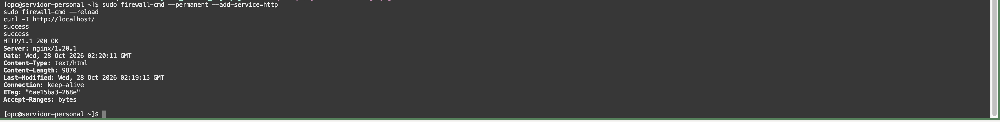

### Paso 3.6. Probar con la dirección IP pública

En el navegador de tu equipo, abre `http://157.137.218.28`. Debe aparecer la página personal.

Después de esta prueba cambié el contenido por una página de repaso de los talleres y la volví a publicar con los comandos de la [Fase 5](#fase-5-resultado-y-mantenimiento) (`git pull` y `git archive`). La captura muestra la versión final.

<!-- Captura: navegador con la página abierta por IP -->
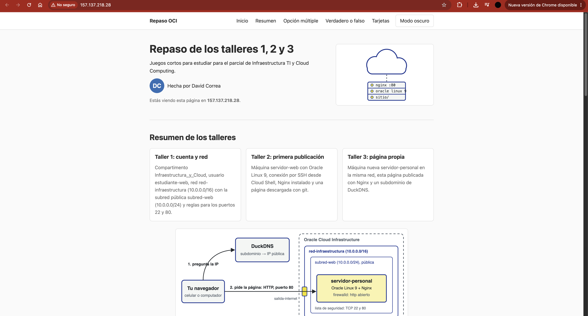

---

## Fase 4. Configurar el subdominio de DuckDNS

DuckDNS es un servicio gratuito de DNS (Domain Name System, sistema de nombres de dominio) que asocia un nombre como `davidcorrea-oci.duckdns.org` con la IP pública del servidor.

### Paso 4.1. Crear el subdominio y apuntarlo a la máquina

1. Abre `https://www.duckdns.org` e inicia sesión con tu cuenta de GitHub o Google.
2. En **sub domain** escribe `davidcorrea-oci` (letras minúsculas, números y guiones) y pulsa **add domain**.
3. En la fila del subdominio, el campo **current ip** muestra la IP de tu casa. Reemplázala por `157.137.218.28` y pulsa **update ip**.
4. Comprueba que la fila muestre la IP de la máquina virtual.

> En la parte superior de DuckDNS aparece un **token**. Es una contraseña: tápalo antes de guardar la captura.

<!-- Captura: panel de DuckDNS con el subdominio y la IP de la VM (token tapado) -->
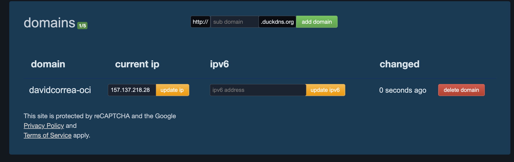

### Paso 4.2. Comprobar que el nombre resuelve a la IP

En la sesión de `servidor-personal`:

```bash
getent hosts davidcorrea-oci.duckdns.org
```

Debe mostrar `157.137.218.28` seguida del subdominio. Si muestra otra IP o nada, espera un minuto y repite.

<!-- Captura: getent hosts mostrando la IP de la VM -->


### Paso 4.3. Configurar Nginx para el subdominio

Se crea un bloque `server` propio para el subdominio, con un registro de accesos separado.

```bash
sudo tee /etc/nginx/conf.d/pagina-personal.conf > /dev/null <<'EOF'
server {
    listen 80;
    listen [::]:80;
    server_name davidcorrea-oci.duckdns.org;

    root /usr/share/nginx/html;
    index index.html;

    access_log /var/log/nginx/pagina-personal.access.log;

    location / {
        try_files $uri $uri/ =404;
    }
}
EOF
```

```bash
cat /etc/nginx/conf.d/pagina-personal.conf
sudo nginx -t
sudo systemctl reload nginx
```

| Directiva | Qué hace |
| --- | --- |
| `listen 80` | Atiende HTTP en el puerto 80 (IPv4 e IPv6) |
| `server_name` | Asocia este bloque con el subdominio |
| `root` | Carpeta de donde salen los archivos |
| `index` | Archivo que se entrega al abrir la dirección sin ruta |
| `access_log` | Registro de cada visita a la página |
| `try_files ... =404` | Entrega el archivo pedido o responde 404 si no existe |

`nginx -t` debe responder `syntax is ok` y `test is successful`; `reload` aplica la configuración sin detener el servicio.

<!-- Captura: archivo de configuración, nginx -t correcto y reload -->
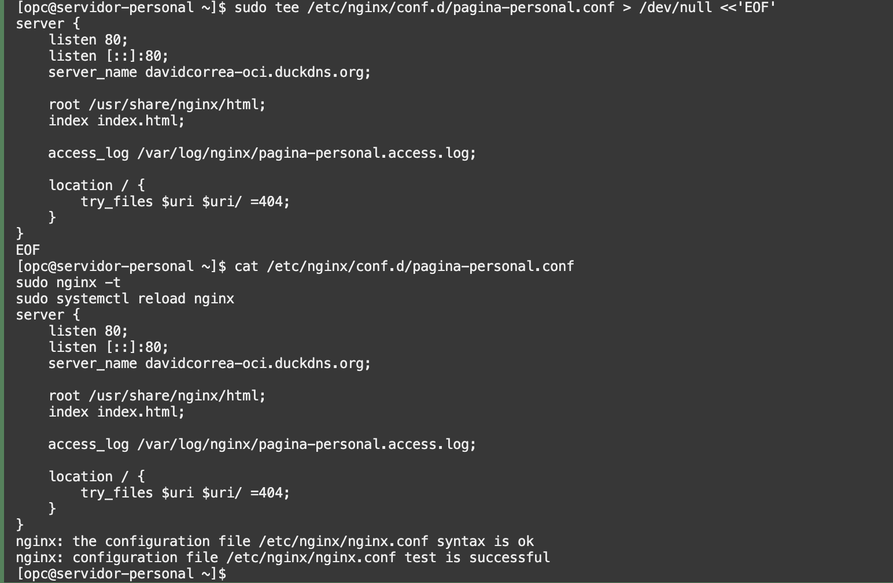

### Paso 4.4. Probar desde fuera de la máquina virtual

1. Escribe `exit` para salir del servidor y volver a Cloud Shell. Ejecuta:

```bash
curl -I http://davidcorrea-oci.duckdns.org
```

Debe responder `HTTP/1.1 200 OK` y `Server: nginx`. Cloud Shell es un equipo distinto a la máquina virtual, así que la prueba llega por Internet.

<!-- Captura: curl -I al subdominio desde Cloud Shell con 200 OK -->
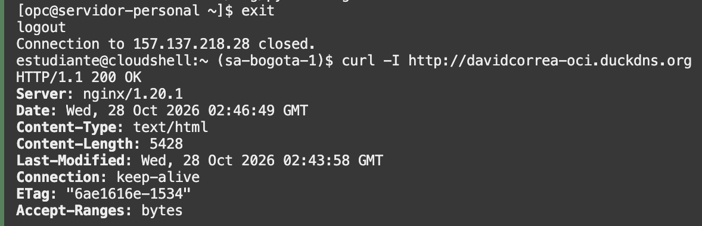

2. En un celular con el wifi apagado (solo datos móviles), abre `http://davidcorrea-oci.duckdns.org`. Escribe `http://` al inicio: la página no usa HTTPS y algunos navegadores muestran un aviso de conexión no segura; en ese caso elige continuar al sitio.

<!-- Captura: página abierta en el celular con datos móviles, mostrando la dirección -->
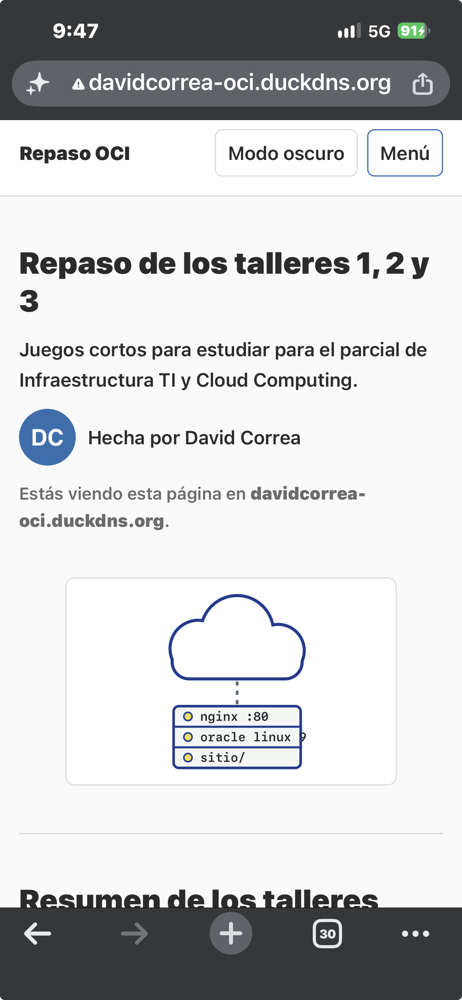

3. Prueba la funcionalidad en JavaScript: responde algunas **Preguntas de opción múltiple** (una bien y una mal) y algunas de **Verdadero o falso**, y voltea una de las **Tarjetas de repaso**. Prueba también el botón **Modo oscuro** y el menú del celular.

<!-- Captura: preguntas respondidas, con una correcta y una incorrecta -->
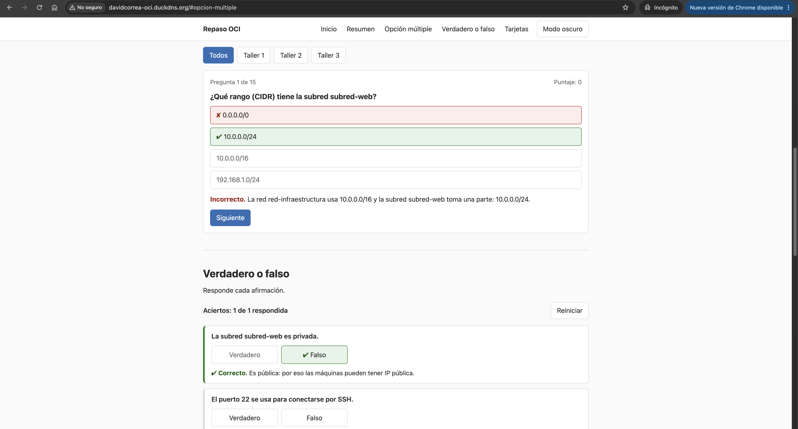

### Paso 4.5. Revisar las visitas en el registro de Nginx

Vuelve a conectarte a `servidor-personal` (flecha arriba en Cloud Shell repite el `ssh`) y ejecuta:

```bash
sudo grep -E "iPhone|curl" /var/log/nginx/pagina-personal.access.log | tail -n 5
```

`grep` deja solo las visitas del celular (`iPhone`) y de Cloud Shell (`curl`), y `tail -n 5` muestra las últimas cinco. Cada línea es una visita: la IP de quien abrió la página, la fecha, el archivo pedido y el código de respuesta (`200`). En la captura, las últimas cinco son del celular con datos móviles.

<!-- Captura: registro de accesos con las visitas externas -->
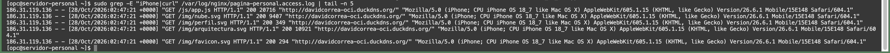

---

## Fase 5. Resultado y mantenimiento

| Entregable | Dirección |
| --- | --- |
| Página publicada | http://davidcorrea-oci.duckdns.org |
| Guía | https://github.com/DavoCor/pagina-personal-oci/blob/main/README.md |

La máquina `servidor-personal` queda encendida para la verificación del docente. La IP pública de la máquina se conserva mientras la instancia exista; si alguna vez cambia, se actualiza en el campo **current ip** de DuckDNS.

Para publicar cambios hechos en el repositorio:

```bash
git -C ~/pagina-personal pull
git -C ~/pagina-personal archive --format=tar HEAD:sitio | sudo tar -x -C /usr/share/nginx/html
sudo restorecon -Rv /usr/share/nginx/html
```

Después de la calificación, la máquina se elimina como en la fase 3 del taller 2: **Terminate** con **Permanently delete the attached boot volume** activado.

---

## Solución de problemas

| Síntoma | Qué revisar |
| --- | --- |
| `Connection timed out` al usar `ssh` | Cloud Shell en **Public Network**, IP correcta, estado **Running**, regla del puerto 22 |
| `Permission denied (publickey)` | Usuario `opc` y la llave `llave-personal.key` de esta máquina, no la del taller 2 |
| `WARNING: REMOTE HOST IDENTIFICATION HAS CHANGED` | La IP la usó antes otra máquina; ejecuta `ssh-keygen -R 157.137.218.28` en Cloud Shell y conecta de nuevo |
| La página no abre con la IP | Regla del puerto 80, `sudo firewall-cmd --list-services` debe incluir `http`, `systemctl is-active nginx` debe responder `active` |
| Abre con la IP pero no con el subdominio | IP en DuckDNS y resultado de `getent hosts davidcorrea-oci.duckdns.org` |
| El navegador cambia a `https://` y falla | Escribe la dirección completa con `http://` |
| Aparece la página de prueba de Nginx | Repite el paso 3.4 y recarga con **Ctrl + F5** |
| `403 Forbidden` | Repite `sudo restorecon -Rv /usr/share/nginx/html` |
| Faltan estilos o imágenes | La carpeta `sitio` debe tener dentro `css`, `js` e `img`; GitHub y Linux distinguen mayúsculas y minúsculas |
